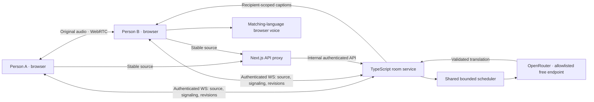
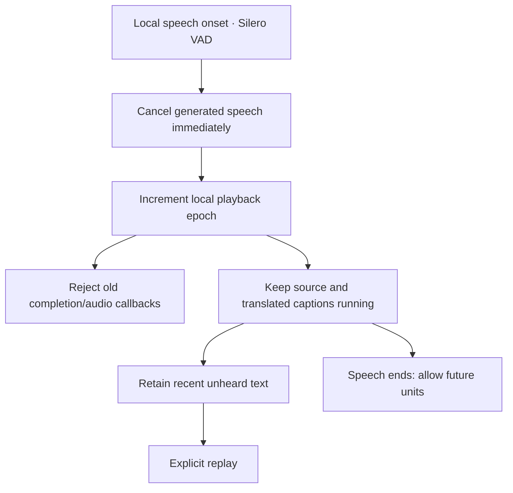

# Argue — Relay

A Next.js + TypeScript alpha for two people who speak different languages. The selected Relay screen is implemented as a working, explicitly labeled demo; private rooms use real signaling and separate WebRTC audio tracks.

## Run locally

Requires Node 20.9 or newer (developed with Node 24.14.1).

```powershell
npm install
Copy-Item .env.example .env  # only if you do not already have .env
npm run dev
```

Open http://localhost:3000. The launcher starts Next.js on port 3000 and the TypeScript room service on port 8787. VAD assets are copied from installed packages before dev/build. Your existing key is already stored locally in the ignored `.env`; it is never included in client props, public variables, or Git. A worktree has its own ignored environment file.

For a production-mode local check: `npm run build`, then stop dev and run `npm start`. Both services must run. This project does not provision hosting or TURN.

## Try it

- Explore the Demo without granting microphone permission or making inference calls.
- Select **Start a room**, choose your name and speaking/listening languages, inspect processing details, and create a room.
- Copy the invitation to a second browser or device. Join with a second participant; a third participant is refused.
- Start each microphone explicitly. Both can speak at the same time. The browser’s recognition provides source captions; stable segments go through the server translation adapter.
- Use **Room settings** to enable translated speech or original audio. These are separate lanes and initially off. A matching device voice is required for synthesis.
- Type a message when recognition is unavailable. **Correct last** creates a newer revision of your last committed source segment.
- Local speech detection interrupts generated playback; caption and source processing continue. **Replay** explicitly plays the most recent eligible translation from the last 30 seconds.
- Leaving stops tracks, recognition, synthesis, audio contexts, timers, and subscriptions.

## Configuration

| Variable | Purpose |
| --- | --- |
| `OPENROUTER_API_KEY` | Server-only OpenRouter credential |
| `OPENROUTER_MODEL` | Pinned free model; default `google/gemma-4-31b-it:free` |
| `OPENROUTER_ALLOWED_PROVIDERS` | Explicit endpoint slugs; default `google-ai-studio` |
| `OPENROUTER_DATA_COLLECTION` | Default `deny`; provider policy is never relaxed automatically |
| `ROOM_PORT`, `PORT` | Room service and frontend ports |
| `ROOM_SERVICE_SECRET` | Internal API/JWT secret; launcher generates one if absent |
| `NEXT_PUBLIC_ROOM_WS_URL` | Public WS/WSS URL; default uses the page hostname and port 8787 |
| `NEXT_PUBLIC_ICE_SERVERS` | JSON WebRTC STUN/TURN configuration; default empty, suitable for local peer checks |
| `ROOM_ALLOWED_ORIGINS` | Optional comma-separated browser origins when frontend and WS use different hostnames |
| `TRANSLATION_RPM` | Default 18 requests/minute, shared by all rooms |
| `TRANSLATION_CONCURRENCY` | Default 2 active inference requests |
| `TRANSLATION_QUEUE_PER_ROOM` | Default 2 waiting stable units per room |
| `TRANSLATION_TIMEOUT_MS` | Default 5000 ms; failed inference is not retried |

Only variables prefixed `NEXT_PUBLIC_` belong in the browser. TURN credentials in public ICE configuration must be short-lived; do not put long-lived server secrets there. A public release needs a server endpoint issuing temporary TURN credentials.

On 16 October 2026, the OpenRouter catalog listed Google AI Studio as a zero-price endpoint for the selected model. The configured-key synthetic check returned **429 rate_limited**, so successful live translation and bilingual quality were not established. The app surfaces quota/provider failure and retains source captions. There is no automatic paid model, endpoint, or privacy fallback.

## Architecture





Next.js requests do not own long-lived sockets. The room process owns ordered events, membership, and inference capacity; it can be deployed as a separate persistent Node service. A serverless-only deployment needs a different transport backend.

## Privacy and bounds

Rooms expire after 24 hours. Credentials expire after 15 minutes and renew while connected. Disconnected seats are reserved for 60 seconds. Reconnect history is limited to 100 events and 10 minutes. Invites use 192 bits of randomness. WebSocket messages are capped at 16 KiB and validated. Conversation content is not written to operational logs; raw recording is disabled.

WebRTC transport encryption does not mean the translation provider cannot read text. Browser speech recognition may send audio to its browser vendor. Do not describe this pipeline as end-to-end encrypted interpretation. Process restarts erase all rooms.

Source segments cap at 1000 Unicode code points; translation output at 2000; context at six source segments / 3000 characters; completion at 512 tokens. Old source revisions cannot produce newer audible meaning. Generated/delivered/played states are separate; playback is not proof of comprehension.

## Speech and network limits

Desktop Chromium is the first target. Browser recognition is not universal and installed synthesis voices vary. Unsupported recognition has typed input; unsupported synthesis has captions. No other language is silently substituted.

Silero runs locally for speech onset, but browser recognition captures its own microphone input because the Web Speech API does not accept our WebRTC stream. We never programmatically route remote or generated audio into recognition. Physical speaker-to-microphone echo remains possible: use headphones. Real simultaneous speech, echo isolation, language accuracy, and cross-network latency need two-person bilingual testing.

Localhost is a secure browser context. Another device visiting a LAN HTTP address may not get microphone APIs. Internet calls need HTTPS, WSS, appropriate origin configuration, and usually a TURN relay. Do not mistake localhost integration results for deployed network verification.

## Open-source extension points

The `TranslationAdapter` interface in `server/translation.ts` can be replaced by a local HTTP model service. Browser speech adapters can be replaced independently; keep one recognition lane per participant and preserve revision/epoch cancellation.

| Component | Candidate | License / practical constraint |
| --- | --- | --- |
| Local ASR | [faster-whisper](https://github.com/SYSTRAN/faster-whisper), [whisper.cpp](https://github.com/ggml-org/whisper.cpp) | MIT; streaming needs chunking/stability logic and compute |
| Voice activity | [Silero VAD](https://github.com/snakers4/silero-vad), [vad-web](https://github.com/ricky0123/vad) | MIT; current browser interruption adapter |
| Hindi ↔ English | [IndicTrans2](https://github.com/AI4Bharat/IndicTrans2) | MIT project; verify exact weight card and gated download terms |
| Spanish ↔ English | [OPUS-MT](https://github.com/Helsinki-NLP/Opus-MT) | Verify the exact directional model card/license |
| Multilingual translation | [MADLAD-400 3B](https://huggingface.co/google/madlad400-3b-mt) | Apache 2.0 model; requires hosting resources |
| Local TTS | [Kokoro 82M](https://huggingface.co/hexgrad/Kokoro-82M) | Apache 2.0 weights; verify the chosen language voice and runtime |

Free downloads are not free GPU hosting or latency guarantees. Hugging Face hosted quotas, model licenses, and NVIDIA trial terms must be checked for the specific service at deployment time. Noncommercial model variants are not interchangeable with permissively licensed alternatives.

## Checks and evidence

```powershell
npm run lint
npm run typecheck
npm test
npm run build
npm run check:provider  # one synthetic external inference request; may return quota/availability failure
```

Tests use real room/HTTP/WebSocket code and synthetic provider/media boundaries. They cover duplicate/stale revisions, two-person capacity, expiry, reconnect history, unauthorized identity claims, payload bounds, inference capacity/timeouts, output validation, playback epochs, and late resource cleanup.

The saved design comparison and responsive browser evidence are in `design-qa.md` and `docs/qa/`. Actual microphones and cross-network speech quality are reported separately from these checks.

Development tooling audit: npm reports five high-severity entries through Next’s ESLint plugin → fast-glob → micromatch → braces. These are build/lint dependencies rather than the production speech/room path. The registry suggested downgrading Next’s lint configuration across major versions; this build does not make that incompatible change. Reassess the upstream advisory before production CI handles untrusted patterns.

No account system, recording archive, judging, emotion profiling, voice cloning, group rooms, payment integration, public deployment, or claimed production reliability is included.

